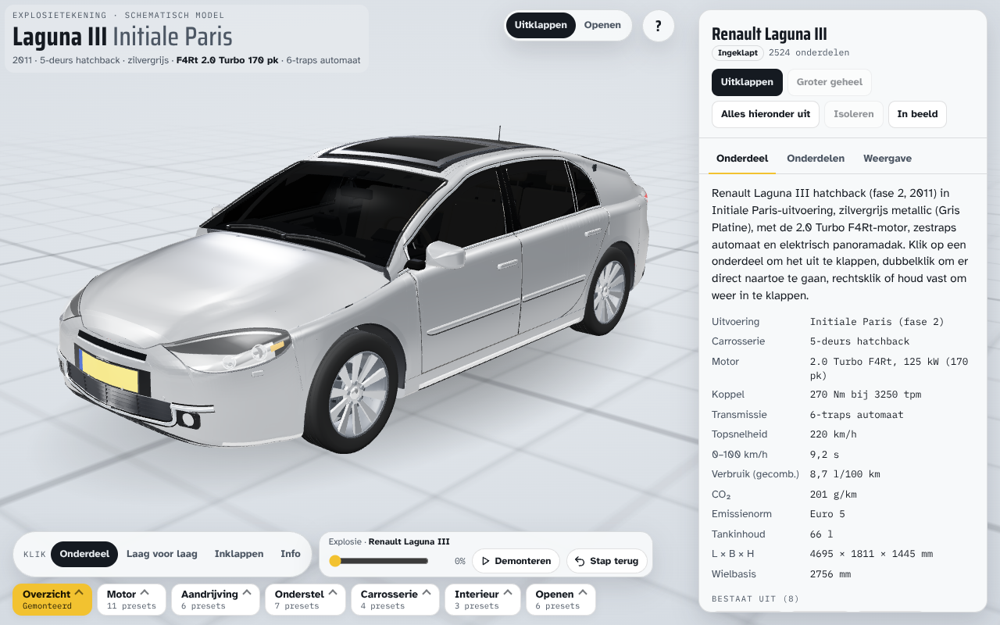
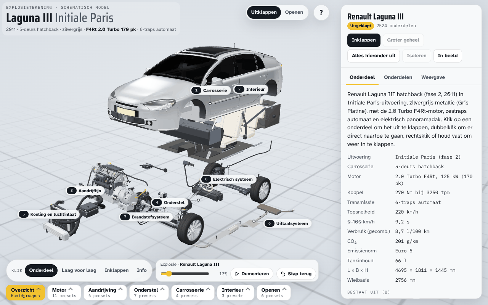
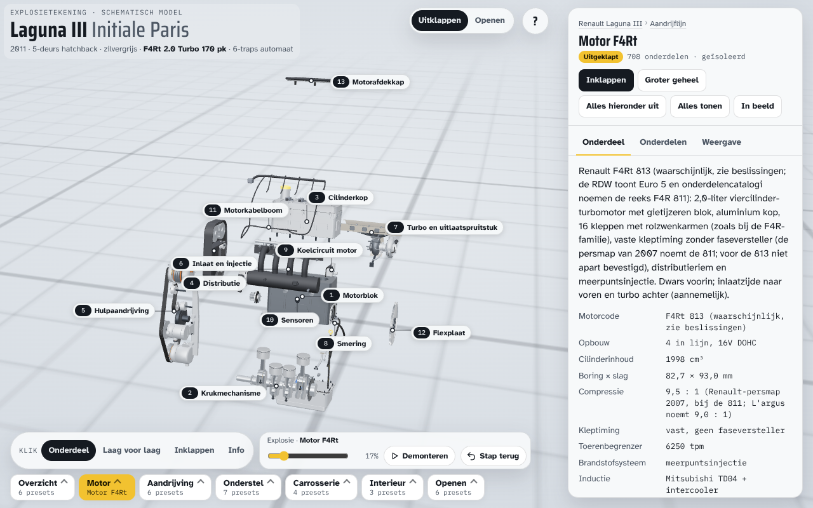
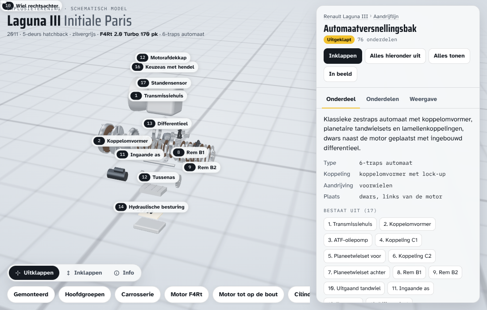
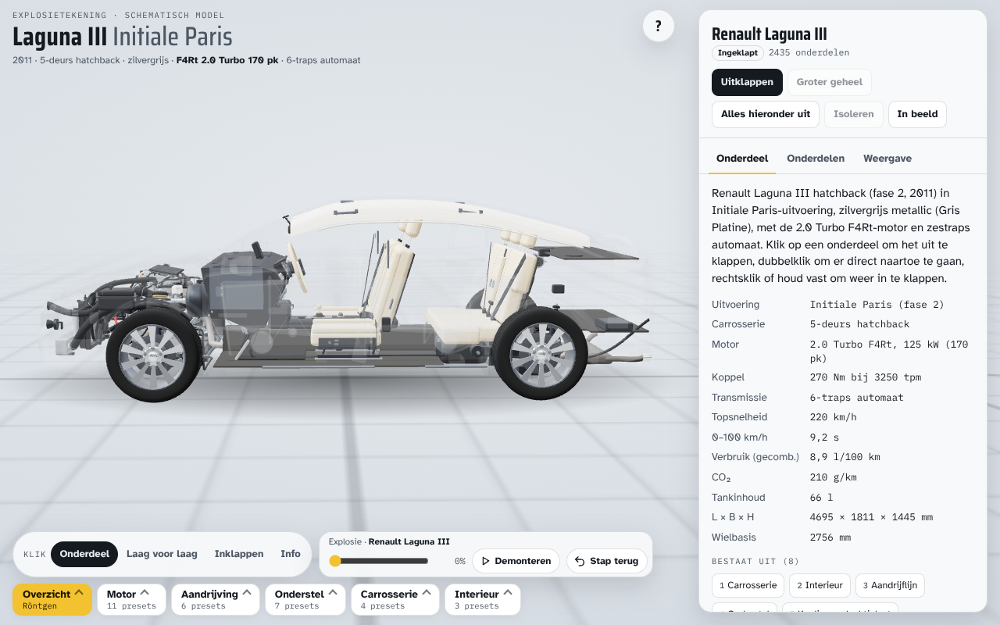
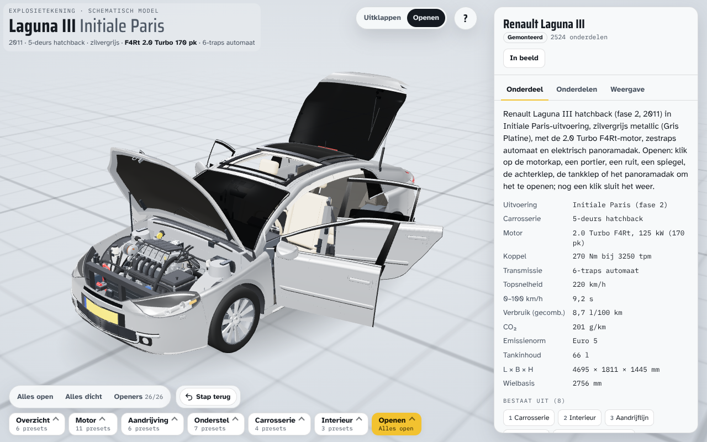
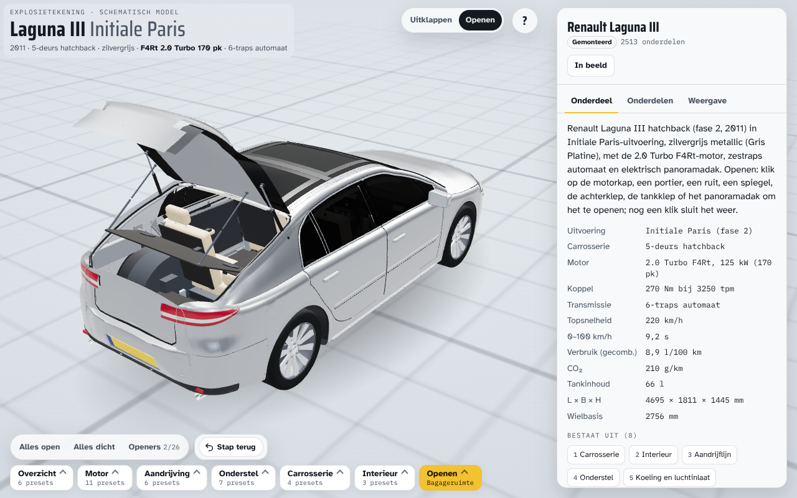
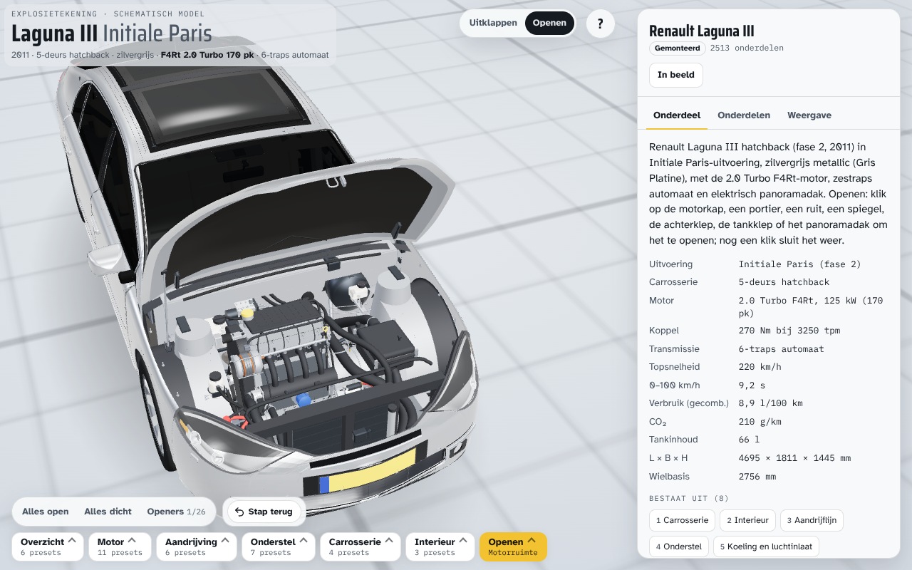
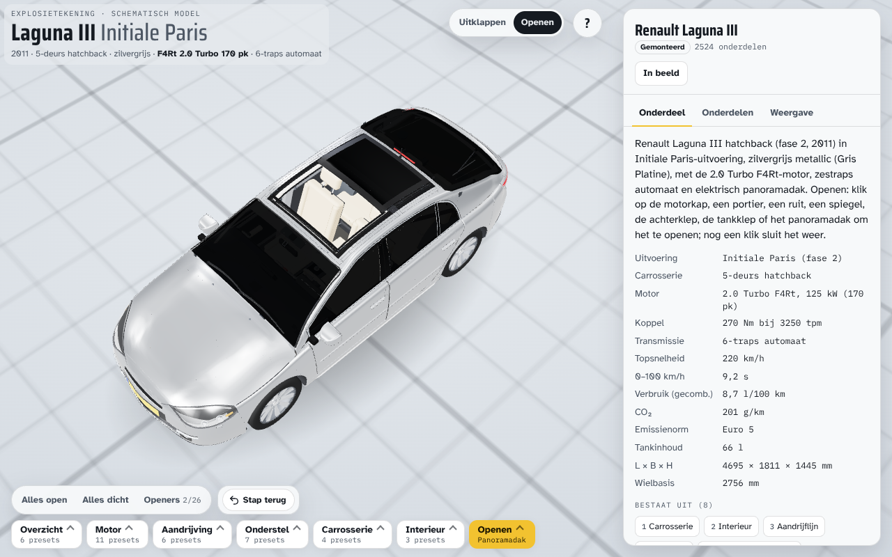

# Laguna III explosietekening

Interactieve 3D-explosietekening van een Renault Laguna III hatchback (fase 2, 2011) in de uitvoering Initiale Paris: zilvergrijs (Gris Platine D69), met de 2.0 Turbo F4Rt-motor (170 pk) en de zestraps automaat Jatco JF613E (Renault AJ0). Het model bestaat uit 2.513 losse onderdelen in 499 groepen, tot 8 lagen diep (3.012 knopen, 659.496 driehoeken). Elke groep klapt apart uit en in, tot op klepspie, zuigerveer en remzuiger. Een tweede modus, Openen, laat de motorkap, de portieren, de ruiten, de achterklep, het panoramadak en een reeks interieurdelen open gaan zoals bij de echte auto. Het paneel toont per onderdeel de bekende onderdeelnummers. Alle geometrie wordt in code opgebouwd; er zijn geen 3D-bestanden.



## Openen

Open `index.html` in een moderne browser. Het bestand laadt three.js r147 van jsDelivr en lettertypes van Google Fonts. Verder is alles ingebouwd. Het werkt op desktop en telefoon, in licht en donker thema (het thema volgt het systeem).

De eerste keer toont de pagina een korte hint. Die verdwijnt na de eerste handeling of na negen seconden en komt daarna niet terug (de browser onthoudt dat). De knop `?` rechtsboven opent de uitleg van de bediening.

## Bediening

### Op een onderdeel

| Gebaar | Wat er gebeurt |
|---|---|
| Klik of tik (modus Onderdeel) | De eigen groep van het onderdeel klapt ter plekke uit. De rest van de auto blijft staan. Staat die groep al open, dan wordt het onderdeel geselecteerd en een stukje uitgelicht. Een klik klapt nooit een groep boven de eigen groep uit. |
| Dubbelklik of dubbeltik | Duikt naar het onderdeel: alle dichte groepen erboven gaan laag voor laag open en de camera zoomt erop in. De duik gebruikt altijd het onderdeel van de eerste klik. Tussen de twee klikken mag hoogstens 420 ms zitten en hoogstens 26 pixels. |
| Rechtsklik, Shift+klik of lang drukken | Klapt de diepste open groep in die het onderdeel bevat, met alles eronder. Rechtsklik na rechts slepen telt niet. Lang drukken (aanraakscherm) is 500 ms vasthouden zonder te bewegen; na 150 ms loopt een ring vol als terugkoppeling. |
| Klik naast de auto | Selecteert de hele auto (of de geïsoleerde groep). |
| Slepen, rechts slepen, scrollen | Draaien, verschuiven, zoomen. Op een aanraakscherm: één vinger draait, twee vingers knijpen en schuiven. |
| Aanwijzen (muis) | Licht de groep op die een klik zou raken en toont een tip met de naam, het aantal onderdelen en wat de klik doet. |

Een beweging van 7 pixels of meer, of een druk van 600 ms of langer, is slepen en nooit een klik.

### Wat een klik doet: de modi

De schakelaar `Klik` onderin kiest wat een enkele klik doet.

| Modus | Werking |
|---|---|
| Onderdeel | Standaard. De eigen groep van het onderdeel klapt uit; is die al open, dan wordt het onderdeel uitgelicht. |
| Laag voor laag | Klapt de buitenste dichte groep op het pad naar het onderdeel uit, van buiten naar binnen. Dit was het gedrag van versie 1. |
| Inklappen | Een klik klapt de diepste open groep in die het onderdeel bevat. |
| Info | Selecteert alleen en toont de onderdeelkaart. |

Met de pijltjestoetsen links en rechts wissel je tussen de modi.

### Groter geheel, Enter en de explosieschuif

- `Groter geheel` (knop in het paneel): klapt de eerstvolgende dichte groep boven de selectie uit. De knop is grijs als er geen dichte groep boven is.
- Enter: is de selectie een dichte groep, dan klapt die uit. Anders doet Enter hetzelfde als `Groter geheel`. Is er ook geen dichte groep boven, dan klapt Enter een open groep in of tilt een onderdeel uit. Shift+Enter klapt in.
- De schuif `Explosie` onderin werkt op de werkgroep: de geselecteerde groep, anders de geïsoleerde groep, anders de hele auto. Hij haalt die groep laag voor laag uit elkaar. De uitlezing toont het aantal lagen.
- `Demonteren` speelt dat af, `Monteren` zet het terug, `Stop` houdt het aan. Elke handeling met de muis of een toets stopt het afspelen.
- `Stap terug` (of Backspace) maakt de laatste handeling ongedaan. De geschiedenis houdt 50 stappen bij.

### De modus Openen

Naast Uitklappen heeft de pagina een tweede modus. In Openen blijft de auto gemonteerd en gaat een deel open zoals bij de echte auto: de motorkap, de vier portieren, de vier zijruiten, de twee buitenspiegels, de achterklep, de tankklep, het panoramadak en een reeks interieurdelen (26 openers in totaal). De camera kijkt dan in de opening.

| Onderdeel | Wat er gebeurt |
|---|---|
| Segmentknop `Uitklappen \| Openen` | Staat in de bovenbalk, op de telefoon over de volle breedte. Sneltoets O wisselt. Bij het ingaan van Openen staat alles gemonteerd en is de isolatie weg; bij het verlaten gaan alle openers dicht. |
| Klik of tik | De klikregel kijkt naar de openers op het pad van het geraakte onderdeel, van buiten naar binnen. De eerste dichte opener gaat open. Zijn ze allemaal open, dan sluit de binnenste. Een klik op de ruit of spiegel van een dicht portier opent dus eerst het portier. |
| Dubbelklik | Gelijk aan een enkele klik. |
| Rechtsklik, Shift+klik, lang drukken | Sluit de binnenste open opener op het pad. |
| Camera | Bij openen beweegt de camera naar de opening; bij sluiten blijft hij staan. |
| Aanwijstekst | Naam van de opener met "klik om te openen" of "klik om te sluiten", of "niets te openen" bij een onderdeel zonder opener. |
| Dock | `Alles open`, `Alles dicht`, `Openers n/26` en Stap terug. `Openers` opent een lijst met een knop per opener, ook voor wat een klik niet bereikt (een spiegel bij een dicht portier). |
| Paneel | Een badge Open of Dicht bij een opener en Gemonteerd bij een groep. De knop Openen of Sluiten werkt op de geselecteerde opener zelf, ook als het portier eromheen dicht is; bij een ander onderdeel volgt hij de klikregel. Enter doet hetzelfde en Shift+Enter sluit de binnenste open opener. |
| Presets Openen | Motorruimte, Instappen, Bagageruimte, Tanken, Panoramadak en Alles open. |

Groter geheel, de klikmodi en de explosieschuif zijn in Openen verborgen. Stap terug onthoudt de openstand en de modus.

De hoeken en slagen zijn geschat uit foto's, het instructieboekje en het werkplaatshandboek. De bron van de eindstand per opener staat in [docs/ontwerp-en-architectuur.md](docs/ontwerp-en-architectuur.md).

### Het panoramadak

Het model toont de auto met het elektrische panoramadak, zoals de geteste auto het heeft. Het dak heeft twee getinte glaspanelen achter elkaar met een dwarsbalk. Het voorste glas kantelt aan de achterrand en schuift 0,60 m naar achteren boven het vaste achterglas, langs de dakkromming. Eronder zitten twee zonneschermen (voor en achter) met een cassette, de luchtgeleider, de waterafvoer, de hemelbekleding met twee openingen en afwerkring, en de draaiknop in de hemelconsole. In Openen heet het voorste glas Schuifdak; het opent pas nadat het voorste zonnescherm open is. De afmetingen zijn geschat uit foto's.

### Presets en rondleiding

Onderin staan de presets in zeven categorieën: Overzicht, Motor, Aandrijving, Onderstel, Carrosserie, Interieur en Openen. Elke preset bereik je met twee klikken (categorie, dan item). De presets volgen een vaste overgang: eerst klapt dicht wat dicht moet, dan beweegt de camera naar de eindkadrering terwijl open gaat wat open moet, alles samen hoogstens 2,5 seconden. Een preset toont alleen de onderdelen die erbij horen; de rest staat op de achtergrond of is verborgen.

- Aantal presets: 43, de rondleiding meegeteld (in de eerste golf waren het er 31): Overzicht 6, Motor 11, Aandrijving 6, Onderstel 7, Carrosserie 4, Interieur 3, Openen 6. In de herstelronde van golf 2 kwamen er zes bij: Stuurpomp, Koeling en luchtinlaat, Uitlaatsysteem, Accu, Stuurinrichting en Parkeerrem. Golf 4 voegde de categorie Openen toe (zie hieronder).
- Een preset in een andere categorie dan Openen zet de modus terug op Uitklappen.
- `Rondleiding` in Overzicht speelt de belangrijkste presets na elkaar af met een bijschrift per stap, ongeveer vijf seconden per stap. `Stop rondleiding` of Esc breekt af.
- De lijst van presets staat in `src/presets.js`.

### Het paneel

Het paneel rechts (op de telefoon onderaan) heeft drie tabbladen.

| Tab | Inhoud |
|---|---|
| Onderdeel | Kruimelpad, naam, beschrijving, specificaties en de onderdelen waaruit de selectie bestaat. Knoppen: Uitklappen of Inklappen, Duik hierheen (bij een onderdeel), Groter geheel, Alles hieronder uit, Isoleren, In beeld. |
| Onderdelen | De volledige boom met zoekfunctie, bijvoorbeeld "klepveer". Een treffer openen klapt het pad ernaartoe uit en selecteert het onderdeel. |
| Weergave | Spreiding (40 tot 220 %), Labels, Röntgen (carrosserie doorzichtig), Kleuren per systeem, Langzaam draaien, zes camerastanden (Voor, Zij, Achter, Boven, ¾ voor, ¾ achter), de schakelaar `Gesloten groepen samenvoegen` (gebundeld renderen, standaard aan) en de knoppen Alles uitklappen, Alles inklappen en Alles tonen. |

### Onderdeelnummers in het paneel

Het tabblad Onderdeel heeft een sectie Onderdeelnummers. Daarin staan per onderdeel de verkoopeenheid waarin het wordt verkocht, de Renault-nummers en de nummers van andere fabrikanten (per merk), elk met een bewijsniveau. Bij 43 paden staat ook "Onderhoud en bekende problemen" (uit het werkplaatshandboek MR 415 en het kennisrapport van de gebruiker).

Boven de sectie staat een vaste waarschuwing: controleer het nummer altijd op het chassisnummer (VIN) bij de dealer of webwinkel, want catalogi verschillen per bouwdatum en uitvoering.

| Status | Betekenis |
|---|---|
| Past volgens catalogus | De catalogus voor dit type (Autodoc type 23370: Laguna III hatchback 2.0 16V Turbo 170 pk, F4R 811) noemt het artikel op de juiste plaats. |
| Variant: kies op VIN | Meer dan een uitvoering komt in aanmerking; het chassisnummer beslist. |
| Gekozen voor deze auto | Een variant waarvoor de uitvoering van de auto van de gebruiker is vastgesteld, volgens de RDW en het chassisnummer van de gebruiker. Het blok noemt uitvoering, bewijs, zekerheid en grond; de gekozen nummers staan gemarkeerd in de lijst. |
| Niet gevonden | Er is naar gezocht en niets bruikbaars gevonden. |
| Niet onderzocht | Het pad heeft geen regel in de gegevens. |
| Deel van, Deel van set | Het onderdeel zit in een verkoopeenheid en wordt daarmee besteld. |

| Bewijsniveau | Bron van het nummer |
|---|---|
| A | Het artikel staat in de catalogus voor dit type op de juiste plaats. |
| B | Het Renault-nummer van zo'n artikel (OE-lijst van een A-artikel). |
| C | Een kruisverwijzing van een A- of B-nummer (Spareto). |
| D | Alleen uit een advertentie voor een gebruikt onderdeel, niet in een catalogus gecontroleerd. Dit geldt alleen voor de twee panoramadaknummers. |

Alle nummers staan ook in [docs/onderdeelnummers.csv](docs/onderdeelnummers.csv) (pad, verkoopeenheid, relatie, status, merk, nummer, bewijs, opmerking, bron en, waar een uitvoering voor de auto van de gebruiker is gekozen, "gekozen voor deze auto" met de uitvoering; geen productteksten of prijzen). De zoekfunctie in de tab Onderdelen vindt ook een nummer.

Labels zijn genummerde bijschriften met een lijntje naar het onderdeel. Ze verschijnen bij de kinderen van de laatst uitgeklapte groep en vermijden elkaar en de bediening.

### Toetsenbord

De toetsen werken zodra de pagina de focus heeft; het canvas krijgt die bij de eerste aanraking.

| Toets | Werking |
|---|---|
| 0 tot 9 | Presets: 0 Gemonteerd, 1 Hoofdgroepen, 2 Motor F4Rt, 3 Motor tot op de bout, 4 Automaat, 5 Onderstel, 6 Carrosserie, 7 Interieur, 8 Röntgen, 9 Alles uit elkaar |
| Enter | Selectie uitklappen; is die al open, dan het grotere geheel. Shift+Enter klapt in. |
| Backspace | Stap terug |
| Esc | Menu sluiten, afspelen of rondleiding stoppen, de hele auto selecteren |
| ? | Uitleg van de bediening |
| / | Springt naar het zoekveld van de onderdelenlijst (op de telefoon opent het paneel daarvoor) |
| Pijl omhoog, omlaag, links, rechts (niet op een knop) | Door de boom lopen: omhoog is de bovenliggende groep, omlaag het eerste deel, links en rechts de vorige of volgende op hetzelfde niveau. Er klapt niets uit. |
| Pijl omhoog of omlaag, Home, End | Door een geopend presetmenu lopen |

### Beeldkwaliteit

Haperen de eerste frames (gemiddeld meer dan 40 ms over 20 frames tijdens een animatie), dan schakelt de pagina één keer over op een lichte weergave: pixelratio 1 en geen lakglans. Een melding in Weergave vertelt dat, en de schakelaar `Volle kwaliteit` zet het terug. Tijdens grote animaties (meer dan 800 bewegende onderdelen) zakt de pixelratio tijdelijk naar driekwart.

## Mappen

| Pad | Inhoud |
|---|---|
| `index.html` | De gebouwde pagina (identiek aan het gepubliceerde artefact). |
| `src/` | Broncode in delen: opmaak, geometrie, carrosserie, motor, aandrijflijn, onderstel, interieur, systemen, app-logica en presets. |
| `src/panorama.js` | Het panoramadak: dakplaat met twee openingen, glaspanelen, dwarsbalk, zonneschermen met cassette, luchtgeleider en waterafvoer, met hun openers. De hemelbekleding met de afwerkring en de draaiknop in de hemelconsole staan in `src/interior.js`. |
| `src/partnumbers.js` | De onderdeelnummers als gegevens. Gemaakt door `tools/orkestratie/build_pn.py`; niet met de hand bewerken. |
| `docs/onderdeelnummers.csv` | Dezelfde nummers als tabel: pad, verkoopeenheid, status, merk, nummer, bewijsniveau, opmerking, bron en de gekozen uitvoering voor de auto van de gebruiker. |
| `build.py` | Voegt `src/` samen tot `index.html`, controleert de broncode en maakt een testversie. |
| `tools/` | Testscripts (Playwright, headless Chromium) en `anchors.json` met de ankernamen. |
| `tools/opentest.py` | Toetst elke opener op eindstand, ondergrens, botsing, blootleggen, prestaties en spookbatch. |
| `tools/open_allow.json` | De uitzonderingen op de botsingscontrole van opentest: 9 regels, elk met reden. |
| `tools/orkestratie/` | Hulpscripts van de bouwsessie: screenshotsets, eindcijfers, volledige testset in één keer, ruimtebezetting en eigendomscontrole. Zie de README in die map. |
| `docs/` | Specificaties met bronnen, ontwerp en architectuur, testverslag, premortem, screenshots. |
| `docs/v1/index.html` | De eerste versie van de pagina, bewaard als terugvaloptie. |
| `docs/onderzoek/` | Onderzoeksnotities met bronnen: exterieur, motor, automaat, onderstel en interieur, beslissingen bij tegenstrijdige bronnen, UX-audit. |
| `handomdraai.md` | Korte stand van de repo en advies voor de volgende ronde. |

## Bouwen en testen

```bash
python3 build.py                 # schrijft index.html (three.js via CDN)
python3 build.py /pad/naar/test  # maakt ook test/index.html die three.js uit ./three/ laadt
python3 build.py --lint          # controleert alleen (dubbele namen, syntaxis)
python3 build.py --test-only MAP # alleen de testversie, laat index.html ongemoeid
```

De tests gebruiken three.js 0.147.0 uit een lokaal npm-pakket en een Chromium met software-rendering. De korte route:

```bash
python3 tools/smoke.py        # laden, aantallen, console
python3 tools/integrity.py    # boom, ankers, doorsteken, presets
python3 tools/silhouette.py   # carrosserie tegen het gemeten silhouet
python3 tools/itest.py        # bediening op desktop en telefoon
python3 tools/pubsmoke.py     # de CDN-versie in de verpakking van de host
python3 tools/ui_inner.py     # ingesloten (inner) onderdelen mogen van buitenaf niet zichtbaar zijn
python3 tools/ui_inner.py --open  # ingesloten knopen die zichtbaar worden met alles open
python3 tools/opentest.py     # de 26 openers: zes controles per opener
```

De hele set in een keer: `tools/orkestratie/finaltests.sh UITVOERMAP`.

Voorbereiding, alle scripts en de resultaten staan in [docs/testen.md](docs/testen.md).

## Documentatie

- [Specificaties en bronnen](docs/specificaties-en-bronnen.md): wat is bevestigd, aannemelijk of geschat, met bron.
- [Onderzoek](docs/onderzoek/README.md): onderzoeksnotities, de kennisbasis uit het rapport van de gebruiker en het werkplaatshandboek MR 415, en de beslissingen bij tegenstrijdige bronnen.
- [Ontwerp en architectuur](docs/ontwerp-en-architectuur.md): coördinaten, bronbestanden, knoop-API, uitklaplogica, de openmodus, contracten tussen de delen, ontwikkelgeschiedenis.
- [Testen](docs/testen.md): scripts, controles en resultaten.
- [Premortem](docs/premortem.md): waarom de klikregel is veranderd, welke vangnetten er zijn en wat de premortem van golf 4 (openmodus en onderdeelnummers) opleverde.

## Bekende beperkingen

- Het is een schematisch model. Vormen, maten en posities van onderdelen zijn benaderd en niet geschikt als montagevoorschrift. De carrosserie volgt de officiële hoofdmaten en het gemeten silhouet, maar is een eigen vorm zonder merklogo's of typebadges.
- Het inwendige van de automaat volgt de zusterbak (Mitsubishi F6AJA) en de literatuur over de Jatco JF613E. Voor de Renault AJ0 zelf zijn geen werkplaatstekeningen gevonden, dus de koppeling tussen de planetaire sets is schematisch.
- De velgen zijn 18 inch met band 225/45 R18. Voor een Nederlandse Initiale Paris uit 2011 is 17 inch even goed mogelijk. Zie [docs/specificaties-en-bronnen.md](docs/specificaties-en-bronnen.md).
- Niet in het model: 4Control (vierwielbesturing). Dat was een optie.
- Openmodus: de eindhoek of slag van elke opener is geschat uit foto's, het instructieboekje en het werkplaatshandboek; aan de echte auto is niets gemeten. De ondergrens per opener staat in de code (`open.min`), de 9 uitzonderingen van opentest staan in `tools/open_allow.json`; beide worden uitgelegd in [docs/testen.md](docs/testen.md). De visuele poort van golf 4 (negen beoordelaars, drie keer gedraaid met een herstelronde na elke poort) eindigt op 10 kenmerken ja, 7 deels en 0 nee. Deels blijven onder meer de steunstang van de motorkap (op desktop nauwelijks te zien), de opgetilde hoedenplank (leest van achter als vlak liggend) en de camera bij de armsteun en de middenarmsteun. Zie [docs/testen.md](docs/testen.md) en `handomdraai.md`.
- Onderdeelnummers, dekking: van de 2.513 onderdelen hebben er 1.398 een regel in de gegevens (onderzocht) en 648 minstens een nummer. 750 zijn onderzocht zonder nummer te vinden en 1.115 zijn niet onderzocht (vooral interieur, carrosseriedelen en kleine bevestigingsmiddelen). Er zijn 546 verkoopeenheden: 110 passen volgens de catalogus, 71 zijn een variant (kies op VIN) en 365 zijn niet gevonden, waaronder veel groepsknopen zonder eigen verkoopeenheid. In totaal 1.334 nummers: 446 van Renault en 888 van 197 andere merken. Bewijsniveau A heeft 807 nummers, B 436, C 89 en D 2.
- Onderdeelnummers, bronnen: de Renault-catalogi (partsouq, 7zap) zaten achter Cloudflare. Renault-nummers komen daarom vooral uit de OE-lijsten van artikelen van andere fabrikanten. De twee nummers voor het panoramadak komen uit een advertentie (niveau D) en zijn niet in een catalogus gecontroleerd. Catalogi verschillen per bouwdatum en uitvoering; zonder chassisnummer van de gebruiker zijn varianten getoond en niet vastgelegd.
- De CSV bevat alleen nummers en bron-URL's, geen productteksten of prijzen (databankenrecht).
- Het werkplaatshandboek MR 415 en de referentiefoto's staan niet in de repo (rechten van Renault en derden). In de tekst staan alleen korte verwijzingen met paginanummer.
- De stuurbekrachtiging is hydraulisch met een pomp op de multiriem. Dat is aannemelijk voor deze motor, niet met een eigen bron bevestigd.
- De prestaties zijn alleen in een container met software-rendering gemeten. Op een echte telefoon is de framesnelheid niet getest; de pagina schakelt zelf over op een lichte weergave als hij haperen gaat.
- Gebundeld renderen van gesloten groepen staat standaard aan (schakelaar in Weergave). Zonder bundelen heeft de gemonteerde auto 1.867 tekenopdrachten, met bundelen 439; met alles open zijn het er 774 (grens 3.000). De grens van 1.500 voor de gemonteerde stand geldt dus alleen met bundelen.
- De Aandrijflijn heeft 235.534 driehoeken tegen een budget van 240.000 en zit daarmee binnen budget. De hele auto (659.496) blijft binnen het budget van 700.000. Carrosserie telt 187.554 (budget 190.000), Onderstel 110.204 en Interieur 77.612.
- De multiriem is in het model 1.569 mm lang tegen 1.795 mm (7PK1795); de beschrijving in de pagina zegt dat. De positie van de stuurpomp en de routes van de slangen zijn schematisch.
- De voorste langsliggers snijden de aandrijfassen. Dit was al zo en is niet opgelost.
- De torsiebalk ligt in het model boven de vlakke vloer (y 0,25 tot 0,33, vloer y 0,18). Bij de echte auto loopt de balk onder een verhoogd vloerdeel. Van buiten is het niet te zien en het is niet aangepast.
- De veer achter steekt door de voorrand van de bagagevloer in de veerkoker. De koker staat in de bagageruimte als kastje naast de rugleuning; op de echte auto zit daar de zijbekleding, die het model niet heeft.
- Niet gebouwd: UX-punt U19 (de rest dimmen bij het duiken naar een onderdeel) en een zijkolomindeling voor telefoons in liggende stand.
- Interactietest: op de eindstand van golf 4 (`3ab6a8d`) slagen alle 150 controles van `tools/itest.py`, inclusief de openmodus en de onderdeelnummers; zie [docs/testen.md](docs/testen.md). Op `9c731c8` (voor golf 4) slaagden 79 van de 79 controles. Het randgeval van de vorige stand (een telefoontik die een ander deel koos) was een echte app-fout: na de tik stuurde de browser nog een muisklik die op een label viel dat net onder de vinger was geschoven. Dat is opgelost in `src/app2.js` en de test is niet veranderd. Zie [docs/testen.md](docs/testen.md).
- Herkenbaarheid: de laatste visuele poort (poort 5, op `9c731c8`, drie onafhankelijke beoordelaars, meerderheid per kenmerk) vond 7 van de 9 herkenningskenmerken volledig aanwezig. De eis is 7, dus S7 is gehaald. Twee kenmerken zijn deels aanwezig: drie zijruiten met zwarte B-stijl en chromen raamlijst (op galerijformaat leest de B-stijl als dunne lijn en is de raamlijst nauwelijks te zien) en het bovenaanzicht (het leest evenwijdig, zonder heupen; de bouwtekening is per kolom gemeten en de breedte is van net voor de achteras tot de vooras constant binnen 1 %, dus dit is niet aangepast). De einduitlaten, die alle drie de beoordelaars als groot gebrek noemden, zijn daarna opgelost in `ff42dbd` en in de galerij nagelopen. De poort is daarna niet opnieuw gedraaid. Zie [docs/premortem.md](docs/premortem.md), struikeldraad 3.
- Onderkant: bij het nalopen van de meldingen van de gebruiker over de onderkant bleek het interieur door de wielbogen en van onderen te zien. Dat is opgelost met gesloten wielkasten en een vloer tot de wielkast. Stralen loodrecht door de vier wielbogen geven 0 interieurtreffers. Stralen van onderen in zeven richtingen geven 2 randgevallen op ruim 60.000. Die controle is met scripts in het scratchpad gedaan en zit niet in de repo.
- Op de motorkap zijn in het bovenaanzicht donkere spikkels te zien op een vaste plek. Samenvallende vlakken en de omgevingsreflectie zijn uitgesloten. De vermoedelijke oorzaak is de software-rasterisatie in de container. Dat is niet bewezen; op een echte GPU nakijken.
- Van de 345 labelankers over alle 36 presets liggen er 261 op het eigen deel en 0 in de lucht (was 175 en 52). De overige 84 liggen ook op het eigen deel, maar liggen afhankelijk van de camera achter een ander deel.
- Niet getest op een echte telefoon en een echte GPU.
- Alle laadtijden zijn in een container met software-rendering gemeten (de pagina is daar na 5 tot 28 seconden klaar, afhankelijk van de belasting van de machine). Ze zeggen niets over een echt apparaat.
- De gedragingen van de webview van een telefoon-app (lang drukken, sneltoetsen in een iframe) zijn niet te testen in de container. De stijlregels ervoor zijn wel getoetst.
- Niet elke 2.0T 170 automaat uit fase 2 is overal geleverd. Zie [docs/specificaties-en-bronnen.md](docs/specificaties-en-bronnen.md) onder Leverbaarheid.

## Screenshots

| Hoofdgroepen | Motor F4Rt |
|---|---|
|  |  |
| **Automaat** | **Röntgen** |
|  |  |

| **Openen: alles open** | **Openen: bagageruimte** |
|  |  |
| **Openen: motorruimte** | **Openen: panoramadak** |
|  |  |

Openen, instappen (vier portieren open): [docs/screenshots/openen-instappen.png](docs/screenshots/openen-instappen.png)

Alles uit elkaar: [docs/screenshots/alles-uit-elkaar.png](docs/screenshots/alles-uit-elkaar.png)

Telefoonweergave: [docs/screenshots/mobiel.png](docs/screenshots/mobiel.png)

De screenshots in `docs/screenshots/` tonen de stand van golf 4: ze zijn gemaakt uit de bron van `3ab6a8d` met `tools/orkestratie/docshots.py`, via de presets van de pagina, op 1280 x 800 (`mobiel.png` op 390 x 844 met pixelverhouding 2) en met software-rendering in de container.
